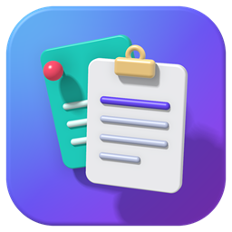
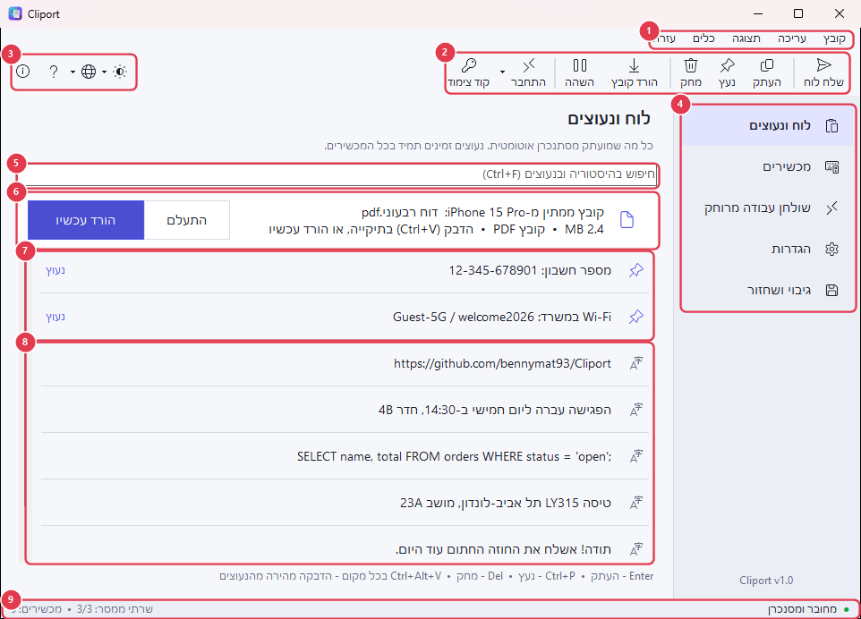

# Cliport v1.0

<p align="center"></p>

לוח (clipboard) משותף בזמן אמת בין מחשבי Windows, אייפון ואייפד. עובד מכל רשת ומוצפן מקצה לקצה.

A real-time shared clipboard for Windows PCs, iPhone and iPad. Works from any network, end-to-end encrypted.

## הורדות · Downloads

| קובץ | למה |
|---|---|
| [Cliport-v1.0-Setup.exe](https://github.com/bennymat93/Cliport/releases/latest/download/Cliport-v1.0-Setup.exe) | Windows: התקנה למשתמש הנוכחי, עם קיצורי דרך והסרה. ללא הרשאות מנהל |
| [Cliport-v1.0-portable.exe](https://github.com/bennymat93/Cliport/releases/latest/download/Cliport-v1.0-portable.exe) | Windows: הפעלה ללא התקנה |
| [Cliport-v1.0-unsigned.ipa](https://github.com/bennymat93/Cliport/releases/latest/download/Cliport-v1.0-unsigned.ipa) | iPhone / iPad: קובץ לא חתום, להתקנה בכלי להתקנת אפליקציות לא חתומות |

כל הקבצים נמצאים ב[עמוד ההורדות](https://github.com/bennymat93/Cliport/releases/latest). הקבצים אינם חתומים דיגיטלית, ולכן Windows עשוי להציג אזהרת SmartScreen בהפעלה הראשונה. אין גרסת Android.

## מדריך למשתמש · User guide

| | |
|---|---|
| עברית | [Cliport-User-Guide-he.pdf](docs/Cliport-User-Guide-he.pdf) |
| English | [Cliport-User-Guide-en.pdf](docs/Cliport-User-Guide-en.pdf) |

המדריך מוטמע גם בתוכנה (מקש `F1`) ובאפליקציה (הגדרות ← מדריך למשתמש).



## יכולות

- **סנכרון בזמן אמת** של טקסט ותמונות. מעתיקים במכשיר אחד, מדביקים באחר.
- **נעוצים** שזמינים בכל המכשירים, עם הדבקה מהירה (`Ctrl+Alt+V`).
- **שיתוף קבצים:** הקובץ עובר רק אחרי אישור שמציג שם, גודל וסוג. תיקייה נשלחת כקובץ zip.
- **טקסט גדול מאוד** (מעל 180KB) מגיע כטקסט וגם כקובץ, לפי המקום שבו מדביקים, או לפי בחירה בהגדרות.
- **שולחן עבודה מרוחק** בלחיצה אחת בין המכשירים (`Ctrl+Alt+R`).
- **עמידות לרשת חלשה:** דחיסה, שידור חוזר של חלקים שאבדו, התאמת קצב והתחברות מיידית בשינוי רשת.
- **התאוששות אוטומטית מקריסות** בחמש דרגות, עם התראה בכל דרגה.
- **גיבוי ושחזור:** גיבוי מלא של התצורה עם שם ותיאור, שמירה מקומית או הורדה לקובץ מוגן בסיסמה, ושחזור בהתקנה חדשה בלי פעולה נוספת.
- **ממשק:** תפריטים, סרגל כלים, חיפוש, ערכות נושא (בהיר / מכשיר / כהה), עברית ואנגלית.

## מה יש בריפו

| נתיב | תוכן |
|---|---|
| `dist/Cliport.exe` | תוכנת Windows מוכנה להרצה, ללא התקנה (דורשת ‎.NET Framework 4.8, שמובנה ב־Windows 10/11) |
| `dist/Cliport-Setup.exe` | קובץ התקנה ל־Windows (`/S` להתקנה שקטה) |
| `windows/src/` | קוד המקור של תוכנת Windows (C#) |
| `ios/` | קוד המקור של אפליקציית iOS/iPadOS (Swift / SwiftUI, ‏iOS 16 ומעלה) |
| `.github/workflows/build-ipa.yml` | בנייה אוטומטית של IPA לא חתום ב־GitHub Actions |
| `docs/` | המדריך למשתמש: מקור, צילומי מסך מסומנים, HTML ו־PDF |
| `assets/` | האייקון |
| `build.ps1` | בניית תוכנת Windows |
| `docs/build-guide.ps1` | בניית המדריך (מצלם את התוכנה, מסמן, מפיק HTML ו־PDF) |

## התקנה

**Windows:** מורידים ומפעילים את קובץ ההתקנה או את הגרסה הניידת (ראה "הורדות"). במחשב הראשון בוחרים "צור קבוצה חדשה", ובשאר המכשירים מזינים את הקוד שהוצג או משחזרים מגיבוי.

**אייפון / אייפד:** מורידים את קובץ ה־IPA (ראה "הורדות") ומתקינים בכלי להתקנת אפליקציות לא חתומות.

## התקנה אוטומטית משורת הפקודה

| פרמטר | פעולה |
|---|---|
| `--restore <file> [--password <pwd>]` | שחזור מקובץ גיבוי בהפעלה, ללא חלונות |
| `--backup <file> [--password <pwd>]` | כתיבת קובץ גיבוי בהפעלה |
| `--join <code>` | הצטרפות לקבוצה עם קוד צימוד |
| `--minimized` | הפעלה למגש המערכת |
| `--lang he\|en`, `--theme light\|system\|dark` | שפה וערכת נושא |

## איך זה עובד

- **צימוד:** כל המכשירים חולקים קוד סודי של 26 תווים. ממנו נגזרים מפתחות ההצפנה (AES-256 + HMAC-SHA256) ושם הערוץ.
- **ממסר:** כל מכשיר מחובר במקביל לשלושה שרתי MQTT ציבוריים על TLS. כל הודעה נשלחת לכולם והמקבלים מסננים כפילויות, כך שמספיק ששרת אחד זמין. אפשר להוסיף שרת פרטי.
- **קבצים:** עד 25MB ישירות דרך הממסר, בחלקים עם שידור חוזר. מעבר לזה דרך אחסון Telegram מוצפן (אופציונלי). ב־Windows הקבצים מוצעים כ"קבצים וירטואליים", כך שההורדה מתחילה רק בהדבקה אמיתית.
- **שולחן עבודה מרוחק:** Remote Desktop של Windows. בין רשתות שונות נדרש Tailscale בכל המכשירים. באייפון החיבור נפתח ב־Windows App של מיקרוסופט.

## מגבלות ידועות

- **אייפון ← מחשב אינו אוטומטי לגמרי.** iOS חוסם קריאת לוח ברקע. הלוח נשלח בפתיחת האפליקציה, או באוטומציה של "קיצורים" (מוסבר במדריך).
- **אישור קובץ ב־iOS** מופיע כשהקובץ מוצע, ולא ברגע ההדבקה.
- **שרתי הממסר הציבוריים** ניתנים ללא התחייבות זמינות. לשימוש קריטי מומלץ להוסיף שרת פרטי.
- **תיקיות** נשלחות כקובץ zip, עד 500MB. באייפון תיקיות אינן נשלחות.
- **הרשימות בחלון אינן נגישות לקורא מסך.**

## מה נבדק

נבדק במחשב Windows עם שני מופעים שמחוברים דרך שרתי הממסר האמיתיים:

- סנכרון טקסט, כולל עברית, אימוג'י ושורות מרובות.
- הדבקת קובץ ב־Explorer עם חלון אישור (אישור ודחייה), והקובץ זהה למקור.
- קובץ של 6MB, וקובץ של 3MB עם אובדן מכוון של 14% מהחלקים (שידור חוזר).
- נעיצה וביטול נעיצה דרך סרגל הכלים, מסונכרנים בין המופעים.
- טקסט של 350KB: מגיע במלואו גם כטקסט וגם כקובץ. תיקייה נשלחת כ־zip עם תתי התיקיות.
- קובץ ההתקנה: התקנה והסרה שקטות במצב בדיקה (תיקייה ורישום נפרדים).
- גיבוי מוגן בסיסמה ושחזור בהתקנה נקייה: המופע המשוחזר מתחבר, מקבל את הנעוצים וההעדפות ומסנכרן עם הקבוצה. סיסמה שגויה נדחית.
- זיהוי ניתוק פתאומי של מכשיר, והפעלה מחדש אחרי קריסה (דרגות 1 ו־2).
- אפליקציית ה־iOS מתקמפלת ב־GitHub Actions.

לא נבדק: הרצה של אפליקציית ה־iOS על מכשיר (כולל גיבוי ושחזור בה, ושחזור קובץ בין Windows ל־iOS), אחסון Telegram (דורש בוט), וחיבור שולחן עבודה מרוחק בפועל.

## בנייה

```powershell
powershell -ExecutionPolicy Bypass -File .\build.ps1
```

```powershell
powershell -ExecutionPolicy Bypass -File .\docs\build-guide.ps1
```
